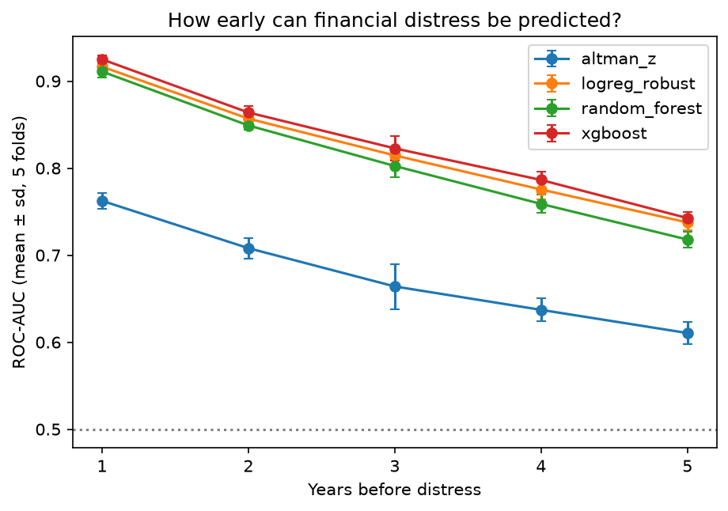
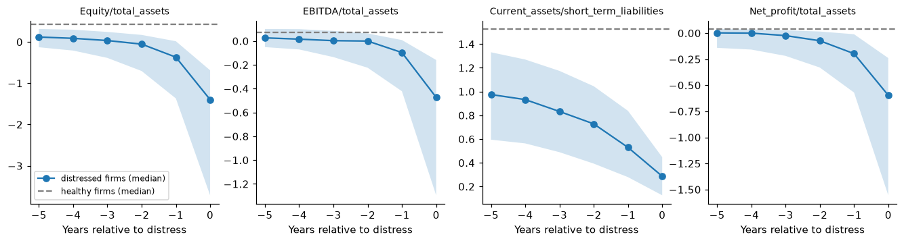
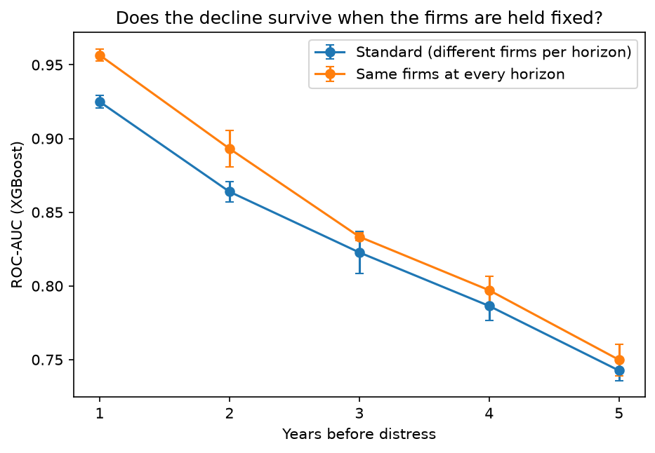
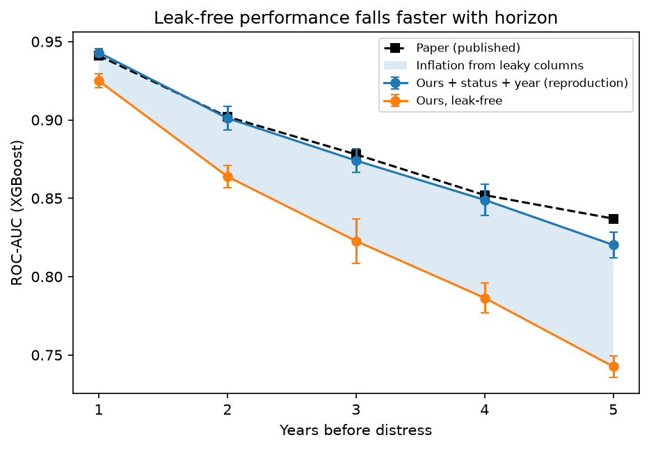
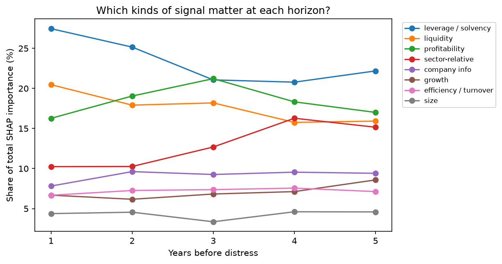

# FinDistress: How Early Can Machine Learning Predict Corporate Financial Distress?

FinDistress measures **how far in advance** corporate financial distress can be predicted from
financial statements, and **which signals warn earliest**. Instead of a single "next year" model,
it trains and compares models at **1, 2, 3, 4 and 5 years before distress**, using a
company-grouped cross-validation protocol and a leak audit of the published benchmark.

> **Headline results**
> - Leak-free XGBoost ROC-AUC falls from **0.925 (1 year ahead)** to **0.743 (5 years ahead)**,
>   still well above chance (0.5) and ~5× better than random on PR-AUC at 5 years.
> - Two columns in the V4FinBench benchmark, `operational_status` and `year`, inflate its reported
>   scores. Including them reproduces the published XGBoost results within 0.004 ROC-AUC at
>   horizons 1–4; removing them lowers ROC-AUC by **0.018 at 1 year and 0.077 at 5 years**.
>   The benchmark therefore **overstates long-horizon predictability**.
> - The decline is not caused by different firms appearing at different horizons: holding the same
>   firms fixed, ROC-AUC still falls from 0.957 to 0.750.
> - **Which signals warn earliest?** One year ahead, the model relies on leverage and liquidity ratios
>   closely tied to the distress definition itself. Five years ahead, the top warning signs are
>   **interest coverage, firm age, asset and receivables growth, and how the firm compares with its
>   industry peers**.
> - A well-preprocessed logistic regression comes within 0.005–0.008 ROC-AUC of XGBoost at every
>   horizon; all machine-learning models beat the Altman Z′-score (1968) by ~0.13–0.16.



---

## Contents
1. [Research questions](#1-research-questions)
2. [Data](#2-data)
3. [Data checks and decisions](#3-data-checks-and-decisions)
4. [Exploratory analysis](#4-exploratory-analysis)
5. [Evaluation protocol](#5-evaluation-protocol)
6. [Models](#6-models)
7. [Results](#7-results)
8. [Leak audit of the benchmark](#8-leak-audit-of-the-benchmark)
9. [Which signals warn earliest? (SHAP)](#9-which-signals-warn-earliest-shap)
10. [Limitations](#10-limitations)
11. [Reproduce](#11-reproduce)
12. [References](#12-references)

---

## 1. Research questions

- **RQ1. How does predictive performance change with the distance to distress?**
  Hypothesis: performance declines as the horizon grows. We did not assume this; it was tested.
- **RQ2. Which financial indicators provide the earliest warning signs?**
  Hypothesis (from the exploratory analysis): balance-sheet and liquidity ratios dominate at long
  horizons, profitability ratios at short horizons.
- **RQ3. Does model complexity pay off?** Logistic regression vs. random forest vs. XGBoost,
  benchmarked against the Altman Z′-score.

## 2. Data

**V4FinBench** (Kostrzewa et al., 2026): financial statements of companies in Poland, Hungary,
Czechia and Slovakia, 2006–2021, derived from EMIS. Licence: CC BY 4.0.
Download from [Kaggle](https://www.kaggle.com/datasets/sebastiantomczak10/v4-group-corporate-bankruptcy/data)
and place the parquet files directly in `data/` (the folder is git-ignored).

**Label.** A company is *distressed* if its final available report shows **all three** of:
negative equity/total assets, negative EBITDA/total assets, and current ratio ≤ 0.6.
This is **financial distress, not legal bankruptcy**. For horizon *h*, the positive row is the
report *h* years before that final distressed report, and later years are removed.

All files were verified against the paper's Table 1:

| File | Horizon (years before distress) | Rows | Distressed | Rate |
|---|---|---|---|---|
| `company_years.parquet` | – (unlabelled panel) | 1,106,879 | – | – |
| `company_years_h1.parquet` | 0 | 1,000,087 | 3,587 | 0.36% |
| `company_years_h2.parquet` | 1 | 996,500 | 3,054 | 0.31% |
| `company_years_h3.parquet` | 2 | 898,692 | 2,374 | 0.26% |
| `company_years_h4.parquet` | 3 | 793,234 | 1,896 | 0.24% |
| `company_years_h5.parquet` | 4 | 700,041 | 1,485 | 0.21% |
| `company_years_h6.parquet` | 5 | 598,832 | 1,154 | 0.19% |

Note the off-by-one naming: file `h2` is the **1-year** horizon. Horizon 0 is excluded from the
experiments because the label is computed from that same year's ratios.

## 3. Data checks and decisions

All checks are in `notebooks/data_preview.ipynb`.

**Column counts.** 142 columns in the panel = 131 features described in the paper + 11 columns the
V4FinBench code drops; the horizon files add `main_label` (143).

**Dropped columns (11)**, matching the V4FinBench preprocessing, confirmed by our own checks:

| Column(s) | Reason |
|---|---|
| `company`, `link`, `emis_id`, `num`, `industry` | Identifiers / text. A model could memorise a company instead of learning from its finances. `company` is kept aside for grouping folds. |
| `sector_2`, `sector_3`, `sector_4` | 97–100% missing |
| `Revenue/employee`, `Fixed_assets/employee` | 100% missing |
| `EBITDA/cash_flow` | 96% missing |

**Excluded from the features (but kept for analysis):**

- **`operational_status`: future-information leak.**
  - Two values. Status 0 covers 118,977 rows (12%) but has a distress rate of 1.11%, vs 0.20%
    for status 1, and contains ~43% of all distressed rows.
  - It is constant within 99.89% of companies (only 209 of 187,525 ever change).
  - Among firms that later become distressed, status 0 is just as common in their early, healthy-
    looking years (46%) as in the labelled year (43%), so it does not track the firm's condition
    at reporting time.
  - Interpretation: it most likely records the company's status *when the data was collected*,
    i.e. its eventual fate. (Inferred from the evidence; not documented in the source.)
- **`year`: label-construction artifact.** The last year allowed in each horizon file can never
  contain a positive, because no later report exists to show distress (e.g. 2020 has 0 positives
  at the 1-year horizon). The distress rate also varies from 0.08% (2006) to 0.61% (2018), partly
  due to data coverage. A model can exploit this without learning anything about companies.

**Missing values are informative, not random:**

| Pattern | Share missing | Meaning |
|---|---|---|
| `*/long_term_liabilities` ratios | 47.8% (identical across them) | Company has **no long-term debt** (division by zero) |
| Growth features | 30–43% | Need the previous year; always missing in a company's first year |
| Cash-flow ratios | ~58% | Most small firms do not report cash flow |
| `ST_financial_assets/current_liabilities_Sector` | 86% healthy vs 93% distressed | Missingness itself differs by class |

Decision: XGBoost uses missing values natively; other models use **median imputation plus a
missing-value indicator per feature** (fitted on training folds only). Columns above 95% missing
are dropped (already in the list above).

**Other checks:** no infinite values (already converted to missing by the dataset authors);
no duplicate (company, year) pairs; ratios have extreme tails (handled with a quantile transform
for logistic regression; tree models are unaffected).

## 4. Exploratory analysis

`notebooks/eda.ipynb`



*Median ratios of firms in the years before distress vs. the median of healthy firms (dashed).*

- Firms that become distressed are **already different five years earlier**: median
  equity/total assets ≈ 0.1 vs ≈ 0.42 for healthy firms; current ratio ≈ 0.97 vs ≈ 1.53.
- **Two kinds of warning signs:** liquidity and equity weaken **gradually** from −5 to 0, while
  profitability (EBITDA/assets, net profit/assets) stays near normal until about −2 and then
  **collapses** in the last one to two years. This motivates the RQ2 hypothesis.
- The year-0 drop is guaranteed by the label definition and is not interpreted.
- Caveat: the set of firms changes along the x-axis (only firms with long histories appear at −5);
  see the same-firm experiment below.

## 5. Evaluation protocol

Implemented once in `src/evaluation.py` and shared by every notebook.

- **Company-grouped 5-fold cross-validation** (`StratifiedGroupKFold`, seed 42): all years of a
  company are in the same fold, and each fold has a similar number of distressed firms.
  An assertion checks that no company appears in two folds.
- **Rotation:** fold *k* = test, fold *k+1* = validation, the remaining three = training.
  This gives five test scores per model and horizon; we report mean ± standard deviation.
- **Preprocessing** (imputation, scaling) is fitted on the training folds only.
- **Decision threshold** is chosen on the validation fold (maximising F1) and applied unchanged to
  the test fold. The test fold is used once.
- **Metrics:** ROC-AUC (primary; insensitive to the class rate, so comparable across horizons),
  PR-AUC reported as **lift** over the random baseline (= distress rate), precision, recall, F1.
  Accuracy is not used: predicting "healthy" for everyone scores 99.7%.
- **Sanity check:** a constant-prediction dummy model scores exactly 0.500 ROC-AUC in every fold.

## 6. Models

| Model | Setup |
|---|---|
| **Altman Z′-score** (1968, private-firm version) | No training: Z′ = 0.717·WC/TA + 0.847·RE/TA + 3.107·EBIT/TA + 0.420·Equity/TL + 0.998·Sales/TA; −Z′ used as the risk score; gaps filled with training medians |
| **Logistic regression (robust)** | Median imputation + missing indicators → quantile transform to a normal distribution (tames outliers) → L2 logistic regression, `C=0.1`, `class_weight='balanced'` |
| **Random forest** | Median imputation + missing indicators; 300 trees, `min_samples_leaf=20`, `max_features='sqrt'`, `max_samples=0.2`, `class_weight='balanced_subsample'` |
| **XGBoost** | 400 trees, learning rate 0.05, depth 6, subsample 0.8, colsample 0.8, `min_child_weight=5`, `hist`; missing values handled natively; not tuned |

**Preprocessing ablation (1-year horizon):** the robust logistic regression (0.917 ROC-AUC) beats a
paper-style version with median imputation and standard scaling (0.896; paper: 0.903) by 0.021, with
a fold-to-fold standard deviation of ~0.005, confirming that missing-value indicators and outlier
handling matter.

## 7. Results

`notebooks/models.ipynb` · per-fold results in `results/04_horizons.csv`

**ROC-AUC (mean of 5 folds)**

| Model | 1 yr | 2 yr | 3 yr | 4 yr | 5 yr |
|---|---|---|---|---|---|
| Altman Z′ | 0.762 | 0.708 | 0.664 | 0.637 | 0.611 |
| Random forest | 0.911 | 0.849 | 0.802 | 0.759 | 0.718 |
| Logistic regression (robust) | 0.917 | 0.857 | 0.815 | 0.775 | 0.738 |
| **XGBoost** | **0.925** | **0.864** | **0.823** | **0.786** | **0.743** |

**PR-AUC lift over random (× better than the distress rate)**

| Model | 1 yr | 2 yr | 3 yr | 4 yr | 5 yr |
|---|---|---|---|---|---|
| Altman Z′ | 5.6 | 3.4 | 2.5 | 1.9 | 1.6 |
| Logistic regression (robust) | 16.3 | 8.3 | 5.6 | 3.7 | 3.0 |
| Random forest | 19.1 | 9.5 | 6.1 | 4.6 | 4.4 |
| **XGBoost** | **22.1** | **10.0** | **7.1** | **5.2** | **4.8** |

**Findings**

- **RQ1:** performance declines steadily with the horizon for every model. The largest single drop is
  from 1 to 2 years (−0.061 for XGBoost), consistent with profitability collapsing only in the final
  one to two years. Distress remains clearly predictable five years ahead.
- **RQ3:** the ranking XGBoost > logistic regression > random forest > Altman Z′ holds at every
  horizon (ROC-AUC). XGBoost's advantage over a well-preprocessed logistic regression is small
  (0.005–0.008). Random forest ranks the very riskiest firms better than logistic regression
  (higher PR-AUC lift) despite a lower ROC-AUC.
- Machine learning beats the 1968 Altman Z′-score by 0.13–0.16 ROC-AUC at every horizon.
- At the 1-year horizon, the robust logistic regression flags firms with ~7% precision at ~25% recall
  (threshold from the validation fold), roughly 24× the base rate. With events this rare, low
  absolute precision is expected and is always reported next to the baseline.

### 7.1 Robustness: the same firms at every horizon

In the standard files, longer horizons contain only firms with longer histories, so the decline in
RQ1 could be caused by *which* firms are present rather than by distance to distress. To rule this
out, every horizon was rebuilt from the same set of firms (`results/05_same_firm.csv`):

- **Positives:** the 1,154 distressed firms with at least six years of history, each appearing once
  per horizon at its report *h* years before distress.
- **Negatives:** rows from never-distressed firms, 2016 or earlier (identical in every horizon file).
- **Folds:** assigned once per company and reused at every horizon.



| XGBoost | 1 yr | 2 yr | 3 yr | 4 yr | 5 yr |
|---|---|---|---|---|---|
| Standard setup, ROC-AUC | 0.925 | 0.864 | 0.823 | 0.786 | 0.743 |
| **Same firms, ROC-AUC** | **0.957** | **0.893** | **0.833** | **0.797** | **0.750** |
| Same firms, PR-AUC lift | 78.1× | 27.9× | 11.8× | 7.8× | 6.2× |

- **The decline survives, and is slightly steeper** (−0.207 vs −0.182 from 1 to 5 years). The
  warning signal genuinely fades with distance.
- Because the distress rate is identical at every horizon here, the PR-AUC lift is directly
  comparable across horizons: the model's highest-risk firms are overwhelmingly true cases one year
  ahead (78×), but that sharpness is largely gone five years ahead (6×).
- Absolute scores are higher than in the standard setup because only never-distressed firms serve
  as negatives, which removes the hardest cases (distressed firms' earlier, already-weak years).
  Compare the shape of the curves, not their level.
- The fixed firms are relatively long-lived companies; the check says nothing about firms with short
  histories.

## 8. Leak audit of the benchmark



XGBoost re-run with the excluded columns added back (`results/05_leak_test.csv`):

| XGBoost variant | 1 yr | 2 yr | 3 yr | 4 yr | 5 yr |
|---|---|---|---|---|---|
| Paper (published) | 0.941 | 0.902 | 0.878 | 0.852 | 0.837 |
| Ours + status + year | 0.943 | 0.901 | 0.874 | 0.849 | 0.820 |
| Ours + status | 0.933 | 0.884 | 0.860 | 0.830 | 0.796 |
| Ours + year | 0.934 | 0.882 | 0.847 | 0.809 | 0.770 |
| **Ours, leak-free** | **0.925** | **0.864** | **0.823** | **0.786** | **0.743** |
| *Inflation (status + year)* | *+0.018* | *+0.037* | *+0.051* | *+0.063* | *+0.077* |

- Adding both columns **reproduces the published scores within 0.004 at horizons 1–4**, so the gap
  between our leak-free results and the paper is explained by these two columns, not by our pipeline.
- The inflation from `operational_status` **grows with the horizon** (+0.008 → +0.053): genuine
  financial signal fades with distance, but a fixed fact about the company's eventual fate does not.
- At 5 years, the two columns account for roughly a quarter of the benchmark's above-chance ROC-AUC
  (0.077 of 0.320). Leak-free performance falls by 0.182 from 1 to 5 years, versus 0.123 with the
  leaky columns: **distress is less predictable far in advance than the benchmark suggests.**
- The 1-year difference is close to fold-to-fold noise; the 3–5-year differences are several times
  larger than it.

## 9. Which signals warn earliest? (SHAP)

**Method.** For each horizon, a final leak-free XGBoost model was trained on all data (saved in
`models/`). SHAP values were computed with XGBoost's exact tree SHAP (`pred_contribs=True`) on all
distressed rows plus 10,000 random healthy rows. Because many ratios are near-duplicates (e.g.
equity/total liabilities and total liabilities/total assets are both transforms of equity/total
assets), single-feature rankings split credit unpredictably, so importance is summed into **feature
families** and reported as each family's share of the total. Per-feature values are in
`results/06_shap_features.csv`.

**Family assignment.** Features were assigned by keyword rules and then corrected by hand, e.g.
interest coverage (`EBIT/financial_costs`), net debt/EBITDA and interest expense/revenue as
leverage/solvency (debt-servicing measures); log operating and net profit as profitability; turnover
ratios that merely contain "liabilities" as efficiency. Counts: profitability 25, liquidity 24,
leverage/solvency 24, sector-relative 17, efficiency/turnover 13, company info 11, growth 8, size 6.



**Share of total SHAP importance (%)** (`results/06_shap_families.csv`)

| Family | 1 yr | 2 yr | 3 yr | 4 yr | 5 yr |
|---|---|---|---|---|---|
| Leverage / solvency | 27.5 | 25.2 | 21.1 | 20.8 | 22.2 |
| Liquidity | 20.5 | 17.9 | 18.2 | 15.8 | 15.9 |
| Profitability | 16.3 | 19.1 | 21.2 | 18.3 | 17.0 |
| Sector-relative | 10.2 | 10.3 | 12.7 | 16.3 | 15.2 |
| Company info | 7.8 | 9.6 | 9.3 | 9.6 | 9.4 |
| Growth | 6.7 | 6.2 | 6.8 | 7.1 | 8.6 |
| Efficiency / turnover | 6.7 | 7.3 | 7.4 | 7.6 | 7.1 |
| Size | 4.4 | 4.6 | 3.4 | 4.6 | 4.6 |

**Top five single features**

| Rank | 1 year | 5 years |
|---|---|---|
| 1 | Equity/total_liabilities | EBIT/financial_costs (interest coverage) |
| 2 | Total_liabilities/total_assets | Equity/total_assets |
| 3 | Operating_expenses/sales | Inventories×365/revenue (vs. sector) |
| 4 | Working_capital/fixed_assets | incorporation_date_1 (firm age) |
| 5 | primary_naics_encoded (industry) | Equity/total_liabilities |

Ranks 6–10 at five years include total-asset growth, receivables growth and interest
expense/revenue.

**Findings**

- **Close to distress, the model reads the label's own ratios.** One year ahead, leverage/solvency
  (27.5%) and liquidity (20.5%) make up nearly half the importance, led by two transforms of
  equity/total assets and, at rank 6, the current ratio: the conditions that *define* distress.
  The 1-year model largely predicts whether these balance-sheet ratios will cross the threshold.
- **Far from distress, the warning signs change.** Five years ahead, the top feature is **interest
  coverage** (can operating profit pay the interest on debt?), followed by equity, **sector-relative**
  measures, **firm age**, and **growth** in assets and receivables. Sector-relative importance rises
  from 10% to 15–16%: long before distress, future failures look like *underperformers relative to
  their industry*.
- **Leverage/solvency is the most important family at every horizon**, with its composition shifting
  from equity-based ratios (1 year) towards debt-servicing capacity (5 years), which is why its share
  rises again at five years.
- **Liquidity's share falls steadily** (20.5% → 15.9%).
- **The RQ2 hypothesis was only partly supported.** From the exploratory analysis we expected
  profitability to dominate close to distress and balance-sheet ratios far from it. Instead,
  balance-sheet ratios dominate close to distress (because of the label definition) and profitability
  peaks in the middle horizons (21.2% at three years).
- **Industry matters** (`primary_naics_encoded` ranks 2–5 at horizons 1–4). It is an industry code
  stored as a number, so this indicates that distress rates differ by industry rather than a precise
  effect.

**Caveats:** shares describe the composition of what the model uses at each horizon, not the strength
of the signal; results depend on the family assignment; SHAP explains the model, not the causes of
corporate failure.

## 10. Limitations

- **Distress, not bankruptcy.** The label is an accounting definition (negative equity, negative
  EBITDA, current ratio ≤ 0.6), not a legal filing.
- **Partly circular label.** Three of the features define the label, and the SHAP analysis confirms
  that the 1-year model relies heavily on them and their near-duplicates. Short-horizon scores
  therefore partly measure "will these ratios cross the threshold?" rather than distress in a broader
  sense. Removing these features and re-running all horizons is left as future work.
- **Different firms per horizon** in the standard files; addressed by the same-firm check
  (Section 7.1), which covers only firms with at least six years of history.
- **`operational_status` interpretation is inferred** from the data, not from documentation.
- **Single seed, untuned models.** Results use seed 42 and fixed hyperparameters; XGBoost was not
  tuned. Conclusions about the leak are robust to this (differences ≫ fold noise at 3–5 years), but
  small model-to-model gaps (< 0.01) should not be over-interpreted.
- **Logistic regression at 5 years** reached the 2,000-iteration limit in some folds; its score fits
  the trend across horizons.
- **Geography and period:** four Central European economies, 2006–2021; results may not transfer to
  other markets.
- **Not a decision tool.** These models are for research; any real use would need further validation
  and human oversight.

## 11. Reproduce

```bash
conda create -n fin-distress python=3.12 -y && conda activate fin-distress
pip install -r requirements.txt
# download the V4FinBench parquet files into data/
jupyter lab   # run data_preview, eda, evaluation, then models
```

```
data/          V4FinBench parquet files (not in git)
notebooks/     data_preview · eda · evaluation · models (incl. leak test, same-firm check, SHAP)
src/           evaluation.py: loading, company-grouped folds, threshold, metrics, CV loop
results/       03_baselines_h1 · 04_horizons · 05_leak_test · 05_same_firm · 06_shap_features · 06_shap_families
figures/       saved plots (fig1–fig8)
models/        final leak-free XGBoost model per horizon (xgb_h1–h5.json), trained on all data;
               their expected performance is the cross-validated estimate in Section 7
```

Load a model with:

```python
import xgboost as xgb
m = xgb.XGBClassifier(); m.load_model('models/xgb_h1.json')
```

Reported runtime on the original laptop (Ryzen 9): the full 4-model × 5-horizon run takes about 1–1.5 hours;
logistic regression is the slowest step.

The dependency ranges in `requirements.txt` are compatibility requirements, not a freeze of the
original training environment. Python 3.12.3 is recorded in the notebooks. Run Jupyter from the
repository root or the `notebooks/` directory. `evperiments.ipynb` is an empty scratch notebook.
Existing result CSVs are reused by the main horizon loop; move them aside to retrain that loop.

Code is released under the [MIT License](LICENSE). The external V4FinBench dataset retains its
own license and attribution requirements and is not distributed here.

## 12. References

- Kostrzewa, M., Tomczak, S., et al. (2026). *V4FinBench: Benchmarking Tabular Foundation Models,
  LLMs, and Standard Methods on Corporate Bankruptcy Prediction.* arXiv:2605.10896.
- Altman, E. I. (1968). Financial ratios, discriminant analysis and the prediction of corporate
  bankruptcy. *The Journal of Finance*, 23(4), 589–609.
- Chen, T., & Guestrin, C. (2016). XGBoost: A scalable tree boosting system. *KDD*.